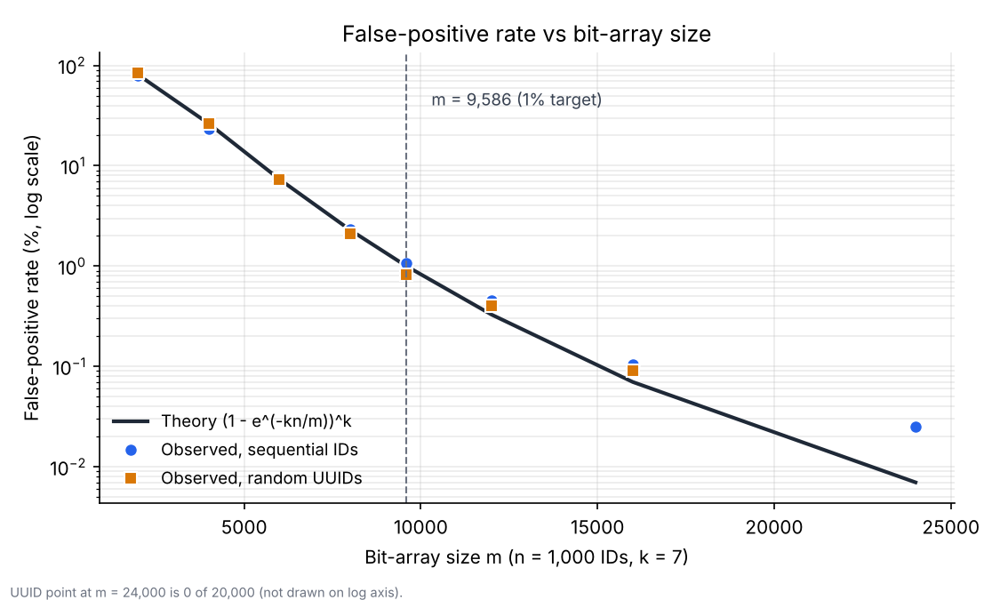

# Bloom Filter MLOps Lab: Answers to Section 14

All numbers below were measured with the project's own classes (`BloomFilter`, `DeduplicationPipeline`, `ExactIdStore`, `BloomSizing`) on the Step 5 stream (seed 42, simulated lookup delay 50 µs) unless stated otherwise. Raw results are in `results/results-table.md`. Timings come from single runs after a warm-up, so treat them as orders of magnitude.

---

## 1. Why must a suspected duplicate be checked against an exact store?

A Bloom filter has **no false negatives but does have false positives**. "Definitely absent" is a guarantee. "Possibly present" is only a hint: it can mean the ID was really seen, or that its k bits happen to have been set by other IDs.

If the pipeline dropped every "possibly present" record without checking, it would silently discard new, valid records. In the Step 5 run, 167 of the 90,000 new IDs were flagged "maybe" although they had never been seen. The exact store is the source of truth and turns the hint into a decision:

- in the store → confirmed duplicate, discard
- not in the store → false positive, accept

This is tested by `possibleMatchIsNeverDiscardedWithoutExactConfirmation`.

## 2. How can false positives affect a training dataset if the pipeline drops all possible duplicates?

Every false positive is a **new, valid record lost**. The loss is not negligible and not uniform:

- **Volume.** The loss is about the false-positive rate (FPR) times the number of new records. With the properly sized filter (m ≈ 862,700, k = 7) it is about 0.19% (167 of 90,000), but with the undersized filter of Step 8 run D (m = 1,000, k = 3, n = 300) about 21% of new records would disappear.
- **Bias over time.** The FPR grows as the filter fills. Early records are almost never lost, late ones are lost at close to the design rate. If the stream is ordered (by date, by class, by customer), the later part of the stream is under-represented, which shifts the training distribution.
- **Rare classes.** A rare class loses the same fraction as the others, but it has few examples to begin with, so the loss hurts its recall most.
- **Invisible.** Nothing is logged for a record that was silently dropped, so the problem is hard to detect.

Mitigation: confirm in the exact store (as this pipeline does), size the filter for the target FPR, and monitor `falsePositives`.

## 3. What happens when the Bloom filter is rebuilt from incomplete data?

The IDs missing from the new filter become **false negatives**: the filter answers "definitely absent" for IDs that were already accepted.

- If the filter is the only check, those duplicates are accepted again.
- In this pipeline the damage is limited, because `addIfAbsent()` is the final arbiter and rejects the duplicate anyway. The test `staleFilterCannotCauseDoubleAcceptance` shows this. But the "lookups avoided" metric is then wrong, and the pipeline does hidden work it believes it skipped.

The reverse also matters: if the filter is rebuilt from **more** data than planned, it fills up and the FPR rises above the design target.

Fix: treat the exact store as the source of truth and call `rebuildFilterFromExactStore()` at startup and after any suspected inconsistency (`rebuildFromExactStoreRestoresTheFilter`).

## 4. How would two parallel workers avoid accepting the same ID simultaneously?

The decision must be made by **one atomic operation**, not by two steps (check, then write). The pipeline already does this: `ExactIdStore` is backed by `ConcurrentHashMap.newKeySet()`, whose `add()` is atomic, so for the same ID exactly one worker gets `true` and the other gets `false`.

What stays unsafe in the lab code if it is used from several threads:

| Component | Problem | Fix |
|---|---|---|
| `BloomFilter` (`boolean[]`) | Writes may not be visible to other threads, so a worker can see a stale "absent". The arbiter still prevents double acceptance, but lookups are wasted. | `AtomicLongArray` with CAS on packed words, or a shared filter |
| `PipelineMetrics` (`long++`) | Increments are lost under concurrency | `LongAdder` or `AtomicLong` |

For several machines: use the store's own atomic primitive (Redis `SET NX`, SQL `INSERT ... ON CONFLICT DO NOTHING` with a unique key), or **partition the stream by `hash(id) % workers`** so that the same ID always goes to the same worker.

## 5. Compare memory, exact-store lookups and runtime with the exact-store-only baseline (Step 5)

Same stream (90,000 unique + 10,000 repeated IDs), identical decisions: 90,000 accepted, 10,000 duplicates.

| Metric | Exact store only | Bloom-gated |
|---|---|---|
| Exact-store lookups | 100,000 | 10,167 |
| Lookups avoided | 0 | 89,833 (89.8%) |
| False positives | n/a | 167 (0.19% of new IDs) |
| Runtime (50 µs per lookup) | 5,224 ms | 650 ms (8× faster) |
| Extra memory for the filter | 0 | 862,656 bits: about 842 KiB with `boolean[]`, about 105 KiB if bit-packed |
| Memory of the exact store | about 8.4 MB (≈ 94 bytes per ID, rough heap measurement) | same |

The lookups drop from N to D + FP = 10,000 + 167. The filter costs roughly 10% (`boolean[]`) or 1.3% (bit-packed) of the exact store's memory and removes about 90% of the reads.

## 6. Stream with 90% duplicates: how many lookups does the filter still avoid, and when is it no longer worth its memory?

100,000 records in total, filter sized for the number of unique IDs (p = 1%, k = 7):

| Duplicates | Unique IDs | Filter bits | Lookups (Bloom) | Avoided | Baseline time | Bloom time |
|---|---|---|---|---|---|---|
| 0% | 100,000 | 958,506 | 171 | 99,829 | 5,260 ms | 51 ms |
| 10% | 90,000 | 862,656 | 10,167 | 89,833 | 5,224 ms | 650 ms |
| 50% | 50,000 | 479,253 | 50,075 | 49,925 | 5,198 ms | 2,630 ms |
| **90%** | **10,000** | **95,851** | **90,013** | **9,987** | **5,272 ms** | **4,644 ms** |
| 99% | 1,000 | 9,586 | 99,001 | 999 | 5,212 ms | 5,039 ms |

**At 90% duplicates the filter still avoids 9,987 lookups (about 10%).** The reason is structural: every duplicate must be verified, because the filter can only say "maybe", so lookups with the filter ≈ D + FP. What the filter saves is exactly the first occurrence of each ID, about `(1 − duplicate ratio) × N`.

**When is it no longer worth it?** Two views:

- *Memory.* If the filter is sized for the unique IDs, it shrinks as duplicates grow (95,851 bits at 90%, 9,586 at 99%), so lookups avoided per bit of filter stay roughly constant (about 0.1 lookup per bit). The ratio alone never makes the memory "wasted". The memory is wasted only if the filter is sized for the whole stream N without knowing the duplicate ratio: at 90% duplicates it would then be about 10× larger than needed.
- *Time.* The filter adds a small cost per record (at most about 0.2 µs from the delay-0 runs, see question 7) and saves `(1 − d) × L` per record, where L is the lookup cost. It pays off while `(1 − d) × L > filter cost`, i.e. up to a duplicate ratio of about `1 − 0.2 µs / L`. For L = 50 µs that is about 99.6%. With a very high duplicate ratio the saving is real but small in absolute terms (50 ms out of 5.2 s at 99%).

## 7. Simulated lookup delay set to 0: what happens to the time saving?

Same stream, delay 0:

| Stream | Baseline | Bloom-gated |
|---|---|---|
| 90,000 unique + 10,000 duplicates | 18 ms | 38 ms |
| 10,000 unique + 90,000 duplicates | 6 ms | 8 ms |

The saving **disappears and even reverses**: the Bloom-gated version is slower. The lookup counts are unchanged (89,833 avoided), but when the exact store is an in-memory hash set, a lookup costs about as much as computing k = 7 hash positions. The filter then only adds work.

Lesson: a Bloom filter is worth using when an exact lookup is **much more expensive than the filter itself**: a remote database, a disk or SSD index, an API call, a network round trip. It is not worth it in front of an in-memory `HashSet`. The rule of thumb is `L > filter cost / (1 − d)`.

## 8. If the exact store offered a cheap atomic insert-if-absent for every record, would the filter still be needed?

**No.** With a cheap `addIfAbsent()` the baseline needs only one operation per record, whose result is the decision (inserted → accept, already present → duplicate). There is no separate read to avoid, so the filter would add memory and complexity for no gain.

Two details from this pipeline:

- The filter only avoids the `contains()` **read**. For a new ID the pipeline still calls `addIfAbsent()` (a write). If that write is the expensive operation, the filter does not help.
- The filter stays useful when insert-if-absent is *not* cheap (remote store billed per request, high latency, write amplification), or to protect the store from read load. Then it behaves exactly as in this lab.

## 9. Extend the pipeline to read CSV and write accepted records

Implemented in `extensions/DataLoader.java` and `extensions/CsvPipeline.java`. It reads `record_id,feature_a,feature_b`, sizes the filter with `BloomSizing`, runs `pipeline.process()` on every row, writes the accepted rows to a new CSV, and optionally compares each decision with the expected labels.

```java
// DataLoader.java (the key methods)
public static List<DataRecord> readCsv(Path file) throws IOException {
    List<DataRecord> records = new ArrayList<>();
    try (BufferedReader in = Files.newBufferedReader(file, StandardCharsets.UTF_8)) {
        in.readLine(); // header
        String line;
        while ((line = in.readLine()) != null) {
            if (line.isBlank()) continue;
            String[] c = line.split(",", -1);
            records.add(new DataRecord(c[0].trim(), Double.parseDouble(c[1]), Integer.parseInt(c[2].trim())));
        }
    }
    return records;
}
```

Run:

```bash
java -cp target/classes com.example.mlops.CsvPipeline data/incoming.csv reports/accepted.csv data/expected-results.csv
```

Result on the project dataset (`data/incoming.csv`, 100,000 rows):

```
Read 100000 records, wrote 90000 to reports/accepted.csv
m=958506 k=7
Possible duplicates (filter says maybe): 10086
Confirmed duplicates: 10000
False positives (maybe, but new): 86
Accepted records: 90000
Exact-store lookups: 10086
Exact-store lookups avoided: 89914
Mismatches vs expected labels: 0
```

All 100,000 decisions match `expected-results.csv` (90,000 accept, 10,000 duplicate). The first occurrence of an ID is accepted and later ones are rejected.

## 10. Report: false-positive rate vs bit-array size

Filter with n = 1,000 inserted IDs and k = 7, measured with 20,000 unseen IDs (`Bench fpr` in `results/bench/Bench.java`). "Sequential" uses `id-i` / `unseen-i`, "random" uses `UUID.randomUUID()`.



| m (bits) | Theory | Observed, sequential IDs | Observed, random UUIDs |
|---|---|---|---|
| 2,000 | 80.68% | 79.81% | 83.83% |
| 4,000 | 26.28% | 23.47% | 26.44% |
| 6,000 | 7.34% | 7.64% | 7.28% |
| 8,000 | 2.29% | 2.33% | 2.09% |
| 9,586 | 1.00% | 1.07% | 0.82% |
| 12,000 | 0.33% | 0.46% | 0.41% |
| 16,000 | 0.07% | 0.11% | 0.09% |
| 24,000 | 0.007% | 0.025% | 0.000% |

Reading the result:

- The FPR falls roughly exponentially as m grows. Doubling m from 8,000 to 16,000 cuts it from 2.3% to 0.07%.
- Observed and theoretical values agree within sampling noise: with 20,000 tests, a rate of 0.07% is only 14 events, so the last rows are noisy. The `BloomFilter` hashing behaves like an ideal one, with both sequential and random IDs.
- The design point m = 9,586 gives the 1% target, as `BloomSizing` predicts.

---

## Correction to an earlier remark

Earlier I suggested that the 0% false-positive rate in Step 8 came from a weak hash on sequential IDs. The measurements above show that is wrong: with the current `BloomFilter`, run D (m = 1,000, k = 3, n = 300) gives about 20% false positives (21 of 300 in the pipeline). The "0.000%" line printed by `Main.java` is not a valid measurement: it reads `metrics` from a pipeline that never processed any record and divides by a hard-coded 100.
